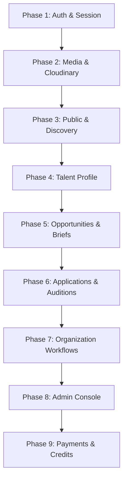

# Vismaya Platform: Frontend & Backend End-to-End Integration Mapping

**Date**: October 2026  
**Status**: Comprehensive Integration Audit & Readiness Report  
**Platform**: Vismaya Creative Studios (Frontend: Next.js App Router | Backend: Node.js / Express 5 / TypeScript / MongoDB)  
**Companion File**: [`docs/integration_map.csv`](file:///c:/Users/kishu/OneDrive/Desktop/vortex/vismaya-final-frontend/docs/integration_map.csv)

---

## 1. Executive Summary & Counts

This document presents a complete audit of all API touchpoints between the Next.js frontend client layer and the Express/MongoDB backend service layer.

The frontend operates under a dual-mode engine configured by `NEXT_PUBLIC_USE_MOCK` and granular per-module switches (`NEXT_PUBLIC_API_MODULES`). All service calls pass through a centralized API client with token injection and response unwrapping.

### 1.1 Overall Integration Status

| Metric | Count | Description |
| :--- | :--- | :--- |
| **Total Frontend Distinct API Calls** | **141** | Distinct client service invocations across 9 domain services + media upload |
| **MATCHED (Ready / Operational)** | **139** | Endpoint method and URL route path match backend registration |
| **MISMATCH (Differences Detected)** | **1** | URL path difference: `GET /api/admin/payments/transactions` vs `GET /api/admin/transactions` |
| **MISSING_IN_BACKEND** | **1** | `GET /api/admin/credits/ledger` (Platform-wide credit ledger view for admin) |
| **Total Backend Registered Endpoints** | **264** | Fully mounted express handlers across 18 route files and mounting aliases |
| **EXTRA_IN_BACKEND** | **121** | Backend routes for 2FA, auto-drafts, webhooks, alias routes, and admin tools |

---

### 1.2 Module-Wise Breakdown

| Domain Module | Frontend Calls | MATCHED | MISMATCH | MISSING IN BACKEND | Backend Routes Available | Extra in Backend |
| :--- | :---: | :---: | :---: | :---: | :---: | :---: |
| **1. Auth & Session** | 13 | 13 | 0 | 0 | 28 | 15 *(2FA, drafts, mobile/email updates)* |
| **2. Public & Discovery** | 12 | 12 | 0 | 0 | 7 | 0 |
| **3. Talent Domain** | 11 | 11 | 0 | 0 | 33 *(mounted on 3 aliases)* | 22 |
| **4. Recruiter / Organization** | 32 | 32 | 0 | 0 | 34 *(org + project routes)* | 2 |
| **5. Applications & Auditions** | 10 | 10 | 0 | 0 | 18 | 8 *(relay/review helpers)* |
| **6. Admin Moderation** | 47 | 46 | 1 | 0 | 95 | 48 *(alias params, review actions)* |
| **7. Media & Uploads** | 12 | 12 | 0 | 0 | 12 | 0 |
| **8. Verifications** | 4 | 4 | 0 | 0 | 4 | 0 |
| **9. Notifications** | 4 | 4 | 0 | 0 | 4 | 0 |
| **10. Payments & Credits** | 6 | 4 | 1 | 1 | 10 | 5 *(webhooks, balance/history)* |
| **TOTAL** | **141** | **139** | **1** | **1** | **264** | **121** |

---

## 2. Global Integration Setup

### 2.1 Base URL & Prefix
- **Frontend Configuration**: Defined in [`frontend/lib/api/config.js`](file:///c:/Users/kishu/OneDrive/Desktop/vortex/vismaya-final-frontend/frontend/lib/api/config.js).
  - Variable: `NEXT_PUBLIC_API_URL`
  - Default: `http://localhost:5000`
  - Client resolution: Every call prepends `${API_URL}/api/...`
- **Backend Port & Base**: Defined in [`backend/src/app.ts`](file:///c:/Users/kishu/OneDrive/Desktop/vortex/vismaya-final-frontend/backend/src/app.ts) and [`backend/src/server.ts`](file:///c:/Users/kishu/OneDrive/Desktop/vortex/vismaya-final-frontend/backend/src/server.ts).
  - Port: `PORT=5000`
  - Base Prefix: `/api` for all functional routes.
  - Health Endpoint: `GET /api/health` returns status `200 OK`.

### 2.2 CORS Policy
- **Backend Configuration** ([`backend/src/app.ts:55-72`](file:///c:/Users/kishu/OneDrive/Desktop/vortex/vismaya-final-frontend/backend/src/app.ts#L55-L72)):
  - Origins: Read from `CORS_ORIGIN`. Defaults include `http://localhost:3000`, `http://127.0.0.1:3000`, `http://localhost:5173`.
  - Credentials: `credentials: true` (allows cookies and authorization headers).
  - Allowed Methods: `GET, POST, PUT, PATCH, DELETE, OPTIONS`.
  - Allowed Headers: `Content-Type, Authorization, x-razorpay-signature, x-draft-token, x-request-id`.
  - Preflight Cache: `maxAge: 86400` (24 hours).

### 2.3 Authentication Mechanism
- **Token Format**: Standard JSON Web Token (JWT) signed with `HS256` using `JWT_SECRET`.
- **Storage**: Client stores token in browser `localStorage` under key `vismaya_auth_token` with an in-memory fallback.
- **Request Injection**: Client automatically injects `Authorization: Bearer <token>` on all requests made via [`apiFetch`](file:///c:/Users/kishu/OneDrive/Desktop/vortex/vismaya-final-frontend/frontend/lib/api/client.js#L145).
- **Session Tracking**: Backend tracks active device sessions in MongoDB collection `UserSession` with `sessionId`.
- **Session Revocation**: `DELETE /api/auth/sessions/:sessionId` and `POST /api/auth/logout-all`.
- **401 Handling**: When backend responds with `401 Unauthorized`, frontend client removes token and redirects to `/login?redirect=...`.

### 2.4 Error Envelope & Parsing
- **Backend Error Shape**:
  ```json
  {
    "success": false,
    "message": "Error description message",
    "errors": ["Specific field error 1", "Specific field error 2"],
    "requestId": "req_1728900000000_abc"
  }
  ```
- **Frontend Error Mapping**: [`frontend/lib/api/client.js`](file:///c:/Users/kishu/OneDrive/Desktop/vortex/vismaya-final-frontend/frontend/lib/api/client.js#L201) parses `data.message || data.error` and creates an instance of `ApiError(message, status, errors, raw)`.

### 2.5 Rate Limiting & Protections
- General API Rate Limiting: 100 requests per 15 minutes (`apiLimiter`).
- Auth Rate Limiting: 10 requests per 15 minutes (`authLimiter`).
- OTP Rate Limiting: 5 requests per 15 minutes (`otpLimiter`).
- Payment Limiter: 15 requests per 15 minutes (`paymentLimiter`).
- Admin Limiter: 300 requests per 15 minutes (`adminLimiter`).
- Payload Size Limits: JSON payloads capped at `2mb`; multipart media uploads capped at `100mb`.

---

## 3. Module-Wise Integration Mapping

### 3.1 Authentication & Session Module (`authService.js`)

| Frontend Call | Method & Path | Backend Endpoint | Status | Notes & Data Contract |
| :--- | :--- | :--- | :---: | :--- |
| `register(payload)` | `POST /api/auth/register` | `POST /api/auth/register` | **MATCHED** | Frontend must send `{ email, password, name, role, mobile }`. Backend role must be `"talent"` or `"organization"`. |
| `verifyRegistration({ email, otp })` | `POST /api/auth/verify-registration` | `POST /api/auth/verify-registration` | **MATCHED** | Verifies 6-digit OTP code, sets `isEmailVerified: true`, issues initial JWT. |
| `resendRegistrationOtp({ email })` | `POST /api/auth/resend-registration-otp` | `POST /api/auth/resend-registration-otp` | **MATCHED** | Rate limited via `otpLimiter`. Sends fresh code via email. |
| `login({ email, password })` | `POST /api/auth/login` | `POST /api/auth/login` | **MATCHED** | Returns `{ success: true, token, sessionId, user: { id, name, role, status } }`. |
| `forgotPassword({ email })` | `POST /api/auth/forgot-password` | `POST /api/auth/forgot-password` | **MATCHED** | Initiates password reset OTP to registered email. |
| `verifyOtp({ email, otp })` | `POST /api/auth/verify-otp` | `POST /api/auth/verify-otp` | **MATCHED** | Validates OTP before password entry form is displayed. |
| `resetPassword({ email, otp, newPassword })` | `POST /api/auth/reset-password` | `POST /api/auth/reset-password` | **MATCHED** | Updates password hash in MongoDB using bcrypt. |
| `changePassword({ currentPassword, newPassword })` | `POST /api/auth/change-password` | `POST /api/auth/change-password` | **MATCHED** | Authenticated call. Requires `newPassword !== currentPassword`. |
| `getSessions()` | `GET /api/auth/sessions` | `GET /api/auth/sessions` | **MATCHED** | Authenticated call. Returns active login sessions for user. |
| `revokeSession(sessionId)` | `DELETE /api/auth/sessions/:sessionId` | `DELETE /api/auth/sessions/:sessionId` | **MATCHED** | Revokes specific session token. |
| `revokeAllSessions()` | `POST /api/auth/logout-all` | `POST /api/auth/logout-all` | **MATCHED** | Revokes all other sessions except current. |
| `loginWithGoogle(idToken, role)` | `POST /api/auth/google` | `POST /api/auth/google` | **MATCHED** | Verifies Google ID Token via Google API client. |
| `logout()` | `POST /api/auth/logout` | `POST /api/auth/logout` | **MATCHED** | Invalidates active user session on server. |

---

### 3.2 Public & Discovery Module (`publicService.js`)

| Frontend Call | Method & Path | Backend Endpoint | Status | Notes & Data Contract |
| :--- | :--- | :--- | :---: | :--- |
| `getPublishedOpportunities(params)` | `GET /api/opportunities/published` | `GET /api/opportunities/published` | **MATCHED** | Public access via `optionalAuth`. Returns public casting calls. |
| `getOpportunityById(opportunityId)` | `GET /api/opportunities/:id` | `GET /api/opportunities/:opportunityId` | **MATCHED** | **Issue P0**: Backend requires `authenticateUser`. Guests get 401. |
| `searchTalentDirectory(params)` | `GET /api/talent/profile/search` | `GET /api/talent/profile/search` | **MATCHED** | **Issue P0**: Backend requires `authenticateUser`. Public search blocked with 401. |
| `getFeaturedTalent()` | `GET /api/talent/profile/featured` | `GET /api/talent/profile/featured` | **MATCHED** | **Issue P0**: Backend requires `authenticateUser`. Landing showcase blocked with 401. |
| `getPublicTalentProfile(id)` | `GET /api/talent/profile/:id` | `GET /api/talent/profile/:vismayaIdOrId` | **MATCHED** | **Issue P0**: Backend requires `authenticateUser`. Public comp-card view blocked with 401. |
| `getPublicCompanyProfile(slug)` | `GET /api/company/:slug` | `GET /api/company/:slug` | **MATCHED** | Public access. Handled by `getPublicCompanyProfile`. |
| `getPlatformStats()` | `GET /api/public/stats` | `GET /api/public/stats` | **MATCHED** | Public statistics endpoint. Backend returns aggregate platform counts. |
| `getSuccessStories()` | `GET /api/success-stories` | `GET /api/success-stories` | **MATCHED** | Public published stories carousel. |
| `submitSuccessStory(payload)` | `POST /api/success-stories` | `POST /api/success-stories` | **MATCHED** | Authenticated. Requires `talent` role. |
| `submitContactForm(payload)` | `POST /api/contact` | `POST /api/contact` | **MATCHED** | Public inquiry form. Stores message and triggers notification. |
| `getTaxonomies()` | `GET /api/taxonomy` | `GET /api/taxonomy` | **MATCHED** | Public. Returns Open Talent and Film & TV taxonomy trees. |
| `getProfessionForm(profession)` | `GET /api/taxonomy/:profession/form` | `GET /api/taxonomy/:profession/form` | **MATCHED** | Public. Returns dynamic schema fields for profession forms. |

---

### 3.3 Talent Domain Module (`talentService.js`)

| Frontend Call | Method & Path | Backend Endpoint | Status | Notes & Data Contract |
| :--- | :--- | :--- | :---: | :--- |
| `getMyProfile()` | `GET /api/talent/profile/my` | `GET /api/talent/profile/my` | **MATCHED** | Authenticated (`talent`). Returns full profile + verification badges. |
| `saveProfile(payload)` | `POST /api/talent/profile` | `POST /api/talent/profile` | **MATCHED** | Authenticated (`talent`). Handled by `createOrUpdateProfile`. |
| `getCompletionStatus()` | `GET /api/talent/profile/completion-status` | `GET /api/talent/profile/completion-status` | **MATCHED** | Authenticated (`talent`). Returns completion percentage & missing sections. |
| `getMyAnalytics()` | `GET /api/talent/profile/analytics` | `GET /api/talent/profile/analytics` | **MATCHED** | Authenticated (`talent`). Returns profile views, appearances, shortlists. |
| `getShareCard(vismayaId)` | `GET /api/talent/:id/share-card` | `GET /api/talent/:vismayaIdOrId/share-card` | **MATCHED** | Publicly accessible share card generation endpoint. |
| `getMyApplications()` | `GET /api/applications/my` | `GET /api/applications/my` | **MATCHED** | Authenticated (`talent`). Returns all opportunities applied to. |
| `applyToOpportunity(oppId, payload)` | `POST /api/applications/:oppId/apply` | `POST /api/applications/:opportunityId/apply` | **MATCHED** | Authenticated (`talent`). Validates application eligibility, limits, and answers. |
| `withdrawApplication(appId, payload)` | `PATCH /api/applications/:appId/withdraw` | `PATCH /api/applications/:applicationId/withdraw` | **MATCHED** | Authenticated (`talent`). Marks status as `withdrawn`. |
| `requestReapplication(appId, payload)` | `POST /api/applications/:appId/reapplication-request` | `POST /api/applications/:applicationId/reapplication-request` | **MATCHED** | Authenticated (`talent`). Sends request to admin review queue. |
| `getMyAuditions()` | `GET /api/auditions/my` | `GET /api/auditions/my` | **MATCHED** | Authenticated (`talent`). Returns scheduled and received audition rounds. |
| `submitSelfTape(audId, payload)` | `POST /api/auditions/:audId/self-tape` | `POST /api/auditions/:auditionId/self-tape` | **MATCHED** | Authenticated (`talent`). Submits video URL + notes + metadata. |

---

### 3.4 Recruiter & Organization Module (`recruiterService.js`)

| Frontend Call | Method & Path | Backend Endpoint | Status | Notes & Data Contract |
| :--- | :--- | :--- | :---: | :--- |
| `getOrganizationProfile()` | `GET /api/organization/profile` | `GET /api/organization/profile` | **MATCHED** | Authenticated (`organization`). Returns studio profile. |
| `saveOrganizationProfile(payload)` | `POST /api/organization/profile` | `POST /api/organization/profile` | **MATCHED** | Authenticated (`organization`). Creates or updates profile. |
| `uploadVerificationDoc(payload)` | `POST /api/organization/verification-doc` | `POST /api/organization/verification-doc` | **MATCHED** | Authenticated (`organization`). Uploads GST/CIN document. |
| `getMyProjects()` | `GET /api/projects` | `GET /api/projects` | **MATCHED** | Authenticated (`organization`). Returns organization projects list. |
| `getProjectById(projectId)` | `GET /api/projects/:projectId` | `GET /api/projects/:projectId` | **MATCHED** | Authenticated (`organization`). Returns project details + shortlists. |
| `createProject(payload)` | `POST /api/projects` | `POST /api/projects` | **MATCHED** | Authenticated (`organization`). Creates new production project. |
| `updateProject(id, payload)` | `PATCH /api/projects/:projectId` | `PATCH /api/projects/:projectId` | **MATCHED** | Authenticated (`organization`). Updates title/type/status. |
| `addToShortlist(id, payload)` | `POST /api/projects/:id/shortlist` | `POST /api/projects/:projectId/shortlist` | **MATCHED** | Authenticated (`organization`). Adds talent to project shortlist. |
| `getProjectShortlist(id, params)` | `GET /api/projects/:id/shortlist` | `GET /api/projects/:projectId/shortlist` | **MATCHED** | Authenticated (`organization`). Lists shortlisted candidates. |
| `updateShortlistItem(pId, sId, pl)` | `PATCH /api/projects/:pId/shortlist/:sId` | `PATCH /api/projects/:projectId/shortlist/:shortlistId` | **MATCHED** | Authenticated (`organization`). Updates notes/role. |
| `removeFromShortlist(pId, sId)` | `DELETE /api/projects/:pId/shortlist/:sId` | `DELETE /api/projects/:projectId/shortlist/:shortlistId` | **MATCHED** | Authenticated (`organization`). Removes talent from shortlist. |
| `getMyOpportunities()` | `GET /api/opportunities/my-opportunities` | `GET /api/opportunities/my-opportunities` | **MATCHED** | Authenticated (`organization`). Returns briefs created by organization. |
| `createOpportunity(payload)` | `POST /api/opportunities` | `POST /api/opportunities` | **MATCHED** | Authenticated (`organization`). Submits brief for moderation. |
| `updateOpportunity(id, payload)` | `PUT /api/opportunities/:opportunityId` | `PUT /api/opportunities/:opportunityId` | **MATCHED** | Authenticated (`organization`). Edits and resubmits casting brief. |
| `requestOpportunityCancellation(...)` | `POST /api/opportunities/:id/cancel-request` | `POST /api/opportunities/:opportunityId/cancel-request` | **MATCHED** | Authenticated (`organization`). Enqueues cancellation for admin review. |
| `completeOpportunity(opportunityId)` | `POST /api/opportunities/:id/complete` | `POST /api/opportunities/:opportunityId/complete` | **MATCHED** | Authenticated (`organization`). Marks brief as completed. |
| `getOpportunityApplications(oppId)` | `GET /api/applications/opportunity/:oppId` | `GET /api/applications/opportunity/:opportunityId` | **MATCHED** | Authenticated (`organization`). Returns applicants for casting brief. |
| `markApplicationUnderReview(appId)` | `PATCH /api/applications/:id/review` | `PATCH /api/applications/:applicationId/review` | **MATCHED** | Authenticated (`organization`). Updates applicant state. |
| `shortlistApplication(appId, pl)` | `PATCH /api/applications/:id/shortlist` | `PATCH /api/applications/:applicationId/shortlist` | **MATCHED** | Authenticated (`organization`). Marks candidate as shortlisted. |
| `selectApplication(appId, pl)` | `PATCH /api/applications/:id/select` | `PATCH /api/applications/:applicationId/select` | **MATCHED** | Authenticated (`organization`). Finalizes candidate selection. |
| `markNotSelected(appId, pl)` | `PATCH /api/applications/:id/not-selected` | `PATCH /api/applications/:applicationId/not-selected` | **MATCHED** | Authenticated (`organization`). Marks candidate as not selected. |
| `requestAudition(appId, payload)` | `POST /api/auditions/application/:appId` | `POST /api/auditions/application/:applicationId` | **MATCHED** | Authenticated (`organization`). Triggers audition round request. |
| `reviewAudition(audId, payload)` | `PATCH /api/auditions/:id/review` | `PATCH /api/auditions/:auditionId/review` | **MATCHED** | Authenticated (`organization`). Submits feedback & rating. |
| `getOrganizationAuditions()` | `GET /api/auditions/organization` | `GET /api/auditions/organization` | **MATCHED** | Authenticated (`organization`). Returns all scheduled auditions. |
| `getCreditBalance()` | `GET /api/credits/balance` | `GET /api/credits/balance` | **MATCHED** | Authenticated (`organization`). Returns balance & consumption stats. |
| `getCreditHistory()` | `GET /api/credits/history` | `GET /api/credits/history` | **MATCHED** | Authenticated (`organization`). Returns ledger transactions. |
| `getViewedTalents()` | `GET /api/credits/viewed` | `GET /api/credits/viewed` | **MATCHED** | Authenticated (`organization`). Returns unlocked talent profiles list. |
| `unlockTalentProfile(talentId)` | `POST /api/credits/unlock/:id` | `POST /api/credits/unlock/:talentIdOrVismayaId` | **MATCHED** | Authenticated (`organization`). Deducts 1 credit and unlocks contact. |
| `getFavourites()` | `GET /api/organization/favourites` | `GET /api/organization/favourites` | **MATCHED** | Authenticated (`organization`). Returns bookmarked talent list. |
| `addFavourite(talentId)` | `POST /api/organization/favourites` | `POST /api/organization/favourites` | **MATCHED** | Authenticated (`organization`). Adds talent to bookmark list. |
| `checkFavourite(talentId)` | `GET /api/organization/favourites/check/:id` | `GET /api/organization/favourites/check/:talentId` | **MATCHED** | Authenticated (`organization`). Returns `{ isFavourite: boolean }`. |
| `removeFavourite(talentId)` | `DELETE /api/organization/favourites/:id` | `DELETE /api/organization/favourites/:talentId` | **MATCHED** | Authenticated (`organization`). Removes talent from bookmarks. |

---

### 3.5 Media & Cloudinary Storage Module (`mediaService.js` & `uploadMedia.js`)

| Frontend Call | Method & Path | Backend Endpoint | Status | Notes & Data Contract |
| :--- | :--- | :--- | :---: | :--- |
| `uploadMedia(file, ...)` | `POST /api/media` | `POST /api/media` | **MATCHED** | Streams multipart/form-data with field name `file`. Uploads to Cloudinary. |
| `getMyMedia()` | `GET /api/media/my` | `GET /api/media/my` | **MATCHED** | Authenticated. Returns current user's media items. |
| `getUserMedia(userId)` | `GET /api/media/user/:userId` | `GET /api/media/user/:userId` | **MATCHED** | Authenticated. Returns public portfolio items for talent ID. |
| `addMedia(payload)` | `POST /api/media` | `POST /api/media` | **MATCHED** | Supports both direct file payload and URL metadata record creation. |
| `updateMedia(mediaId, payload)` | `PATCH /api/media/:mediaId` | `PATCH /api/media/:mediaId` | **MATCHED** | Updates caption, category, tags, or primary photo flag. |
| `deleteMedia(mediaId)` | `DELETE /api/media/:mediaId` | `DELETE /api/media/:mediaId` | **MATCHED** | Soft-deletes record and schedules Cloudinary asset deletion. |
| `uploadMultiple(files)` | `POST /api/media/upload-multiple` | `POST /api/media/upload-multiple` | **MATCHED** | Accepts multipart form with field `files` (array limit: 5). |
| `getUploadSignature()` | `GET /api/media/signature` | `GET /api/media/signature` | **MATCHED** | Returns Cloudinary signed upload token and timestamp. |
| `reorderMedia(payload)` | `PATCH /api/media/order` | `PATCH /api/media/order` | **MATCHED** | Updates sorting order index for portfolio items. |
| `disputeMedia(mediaId, payload)` | `POST /api/media/:id/dispute` | `POST /api/media/:mediaId/dispute` | **MATCHED** | Logs copyright / moderation dispute on media item. |
| `nominateFeatured(mediaId)` | `POST /api/media/:id/nominate-featured` | `POST /api/media/:mediaId/nominate-featured` | **MATCHED** | Requests admin spotlight feature. |
| `featureMedia(mediaId, payload)` | `PATCH /api/media/:id/feature` | `PATCH /api/media/:mediaId/feature` | **MATCHED** | Admin only. Toggles featured status. |

---

### 3.6 Verification Module (`verificationService.js`)

| Frontend Call | Method & Path | Backend Endpoint | Status | Notes & Data Contract |
| :--- | :--- | :--- | :---: | :--- |
| `submitIdentityVerification(payload)` | `POST /api/verifications/identity` | `POST /api/verifications/identity` | **MATCHED** | Submits Aadhaar/Passport doc details + image URLs. |
| `submitProfessionalVerification(payload)`| `POST /api/verifications/professional`| `POST /api/verifications/professional`| **MATCHED** | Authenticated (`talent`). Submits IMDb, credits, work links. |
| `submitBusinessVerification(payload)` | `POST /api/verifications/business` | `POST /api/verifications/business` | **MATCHED** | Authenticated (`organization`). Submits CIN/GST document. |
| `getMyVerifications()` | `GET /api/verifications/my` | `GET /api/verifications/my` | **MATCHED** | Authenticated. Returns verification submission status. |

---

### 3.7 Notifications Module (`notificationService.js`)

| Frontend Call | Method & Path | Backend Endpoint | Status | Notes & Data Contract |
| :--- | :--- | :--- | :---: | :--- |
| `getMyNotifications()` | `GET /api/notifications` | `GET /api/notifications` | **MATCHED** | Authenticated. Returns recent user alerts and broadcasts. |
| `getUnreadCount()` | `GET /api/notifications/unread-count` | `GET /api/notifications/unread-count` | **MATCHED** | Authenticated. Returns `{ success: true, count: number }`. |
| `markAsRead(notificationId)` | `PATCH /api/notifications/:id/read` | `PATCH /api/notifications/:notificationId/read` | **MATCHED** | Authenticated. Sets `isRead: true`. |
| `markAllAsRead()` | `PATCH /api/notifications/read-all` | `PATCH /api/notifications/read-all` | **MATCHED** | Authenticated. Clears unread badge counter. |

---

### 3.8 Admin Domain Module (`adminService.js`)

| Frontend Call | Method & Path | Backend Endpoint | Status | Notes & Data Contract |
| :--- | :--- | :--- | :---: | :--- |
| `getAllUsers(params)` | `GET /api/admin/users` | `GET /api/admin/users` | **MATCHED** | Filterable by role, status, search, pagination. |
| `getPendingUsers()` | `GET /api/admin/users/pending` | `GET /api/admin/users/pending` | **MATCHED** | Returns accounts awaiting manual verification. |
| `approveUser(userId)` | `PATCH /api/admin/users/:userId/approve` | `PATCH /api/admin/users/:userId/approve` | **MATCHED** | Activates account and notifies user. |
| `rejectUser(userId, payload)` | `PATCH /api/admin/users/:userId/reject` | `PATCH /api/admin/users/:userId/reject` | **MATCHED** | Rejects registration with reason note. |
| `suspendUser(userId, payload)` | `PATCH /api/admin/users/:userId/suspend` | `PATCH /api/admin/users/:userId/suspend` | **MATCHED** | Temporarily suspends login privileges. |
| `reactivateUser(userId)` | `PATCH /api/admin/users/:userId/reactivate` | `PATCH /api/admin/users/:userId/reactivate` | **MATCHED** | Restores suspended account to active status. |
| `banUser(userId, payload)` | `PATCH /api/admin/users/:userId/ban` | `PATCH /api/admin/users/:userId/ban` | **MATCHED** | Permanently disables user and revokes all sessions. |
| `unbanUser(userId)` | `PATCH /api/admin/users/:userId/unban` | `PATCH /api/admin/users/:userId/unban` | **MATCHED** | Lifts ban from user profile. |
| `finalizeUserDeletion(userId)` | `POST /api/admin/users/:id/finalize-deletion` | `POST /api/admin/users/:userId/finalize-deletion` | **MATCHED** | Purges PII according to data privacy retention rules. |
| `getTalentDirectory(params)` | `GET /api/admin/talents` | `GET /api/admin/talents` | **MATCHED** | Full roster administration view. |
| `getOrganizationDirectory(params)` | `GET /api/admin/organizations` | `GET /api/admin/organizations` | **MATCHED** | Directory of verified production houses and studios. |
| `updateTalentTrendingStatus(id, pl)` | `PATCH /api/admin/talents/:id/trending`| `PATCH /api/admin/talents/:talentId/trending`| **MATCHED** | Toggles spotlight ranking badge. |
| `getPendingProfileChanges()` | `GET /api/admin/profile-changes` | `GET /api/admin/profile-changes` | **MATCHED** | Queue of critical field change requests. |
| `reviewProfileChange(id, payload)` | `PATCH /api/admin/profile-changes/:id/review` | `PATCH /api/admin/profile-changes/:profileId/review` | **MATCHED** | Approves or rejects name/dob alterations. |
| `getPendingOpportunities()` | `GET /api/admin/opportunities/pending` | `GET /api/admin/opportunities/pending` | **MATCHED** | Moderate briefs submitted by organizations. |
| `getCancellationRequests(params)` | `GET /api/admin/opportunities/cancellations` | `GET /api/admin/opportunities/cancellations` | **MATCHED** | Queue of opportunity cancellation requests. |
| `approveOpportunity(opportunityId)` | `PATCH /api/admin/opportunities/:id/approve` | `PATCH /api/admin/opportunities/:opportunityId/approve` | **MATCHED** | Publishes casting call to discovery board. |
| `rejectOpportunity(id, payload)` | `PATCH /api/admin/opportunities/:id/reject` | `PATCH /api/admin/opportunities/:opportunityId/reject` | **MATCHED** | Rejects opportunity with explanation. |
| `requestOpportunityCorrections(id, pl)` | `PATCH /api/admin/opportunities/:id/request-corrections` | `PATCH /api/admin/opportunities/:opportunityId/request-corrections` | **MATCHED** | Requests edits from organization before publish. |
| `reviewOpportunityCancellation(id, pl)` | `PATCH /api/admin/opportunities/:id/review-cancellation` | `PATCH /api/admin/opportunities/:opportunityId/review-cancellation` | **MATCHED** | Resolves cancellation request with admin notes. |
| `completeOpportunity(opportunityId)` | `PATCH /api/admin/opportunities/:id/complete` | `PATCH /api/admin/opportunities/:opportunityId/complete` | **MATCHED** | Closes casting brief and marks fulfilled. |
| `getReports(params)` | `GET /api/admin/reports` | `GET /api/admin/reports` | **MATCHED** | User flags and content dispute queue. |
| `reviewReport(reportId, payload)` | `PATCH /api/admin/reports/:id/review` | `PATCH /api/admin/reports/:reportId/review` | **MATCHED** | Dismisses report or executes punitive action. |
| `getPendingAuditions(params)` | `GET /api/admin/auditions/pending` | `GET /api/admin/auditions/pending` | **MATCHED** | Relay audition submissions moderation queue. |
| `reviewAudition(auditionId, pl)` | `PATCH /api/admin/auditions/:id/review` | `PATCH /api/admin/auditions/:auditionId/review` | **MATCHED** | Relays approved audition or rejects inappropriate clip. |
| `getReapplicationRequests(params)` | `GET /api/admin/reapplications/pending` | `GET /api/admin/reapplications/pending` | **MATCHED** | Requests by candidates to reapply after withdrawal. |
| `reviewReapplication(appId, pl)` | `PATCH /api/admin/reapplications/:id/review` | `PATCH /api/admin/reapplications/:applicationId/review` | **MATCHED** | Permits or denies reapplication request. |
| `getPendingVerifications()` | `GET /api/admin/verifications/pending` | `GET /api/admin/verifications/pending` | **MATCHED** | Document review queue for KYC and GST. |
| `reviewVerification(verId, pl)` | `PATCH /api/admin/verifications/:id/review` | `PATCH /api/admin/verifications/:verificationId/review` | **MATCHED** | Approves and issues verified platform badge. |
| `getPendingMedia(params)` | `GET /api/admin/media/pending` | `GET /api/admin/media/pending` | **MATCHED** | Media assets awaiting content review. |
| `reviewMediaItem(mediaId, pl)` | `PATCH /api/admin/media/:id/review` | `PATCH /api/admin/media/:mediaId/review` | **MATCHED** | Approves media for portfolio or rejects. |
| `getPaymentTransactions(params)` | `GET /api/admin/transactions` | `GET /api/admin/transactions` | **MATCHED** | System revenue transactions ledger. |
| `adjustCreditBalance(payload)` | `POST /api/admin/credits/adjust` | `POST /api/admin/credits/adjust` | **MATCHED** | Manually grants or deducts organization credits. |
| `getCoupons(params)` | `GET /api/admin/coupons` | `GET /api/admin/coupons` | **MATCHED** | Promotional discount coupons list. |
| `createCoupon(payload)` | `POST /api/admin/coupons` | `POST /api/admin/coupons` | **MATCHED** | Configures new discount promo code. |
| `updateCoupon(couponId, pl)` | `PATCH /api/admin/coupons/:id` | `PATCH /api/admin/coupons/:couponId` | **MATCHED** | Modifies expiration or discount bounds. |
| `deleteCoupon(couponId)` | `DELETE /api/admin/coupons/:id` | `DELETE /api/admin/coupons/:couponId` | **MATCHED** | Deactivates promotional coupon. |
| `getDashboardMetrics()` | `GET /api/admin/dashboard` | `GET /api/admin/dashboard` | **MATCHED** | Topline KPI cards: users, briefs, revenues. |
| `getAuditLogs(params)` | `GET /api/admin/audit-logs` | `GET /api/admin/audit-logs` | **MATCHED** | Chronological record of administrative operations. |
| `globalSearch(query)` | `GET /api/admin/search` | `GET /api/admin/search` | **MATCHED** | Omnibox search across users, briefs, apps. |
| `exportAdminData(type)` | `GET /api/admin/export/:type` | `GET /api/admin/export/:type` | **MATCHED** | Streams CSV file download of platform entities. |
| `getBroadcasts()` | `GET /api/admin/broadcasts` | `GET /api/admin/broadcasts` | **MATCHED** | History of system-wide announcement broadcasts. |
| `getBroadcastById(broadcastId)` | `GET /api/admin/broadcasts/:id` | `GET /api/admin/broadcasts/:broadcastId` | **MATCHED** | Broadcast delivery statistics and details. |
| `sendBroadcast(payload)` | `POST /api/admin/broadcasts` | `POST /api/admin/broadcasts` | **MATCHED** | Dispatches announcement via in-app, email, SMS. |
| `updateBroadcast(broadcastId, pl)` | `PATCH /api/admin/broadcasts/:id` | `PATCH /api/admin/broadcasts/:broadcastId` | **MATCHED** | Edits scheduled broadcast prior to trigger. |
| `deleteBroadcast(broadcastId)` | `DELETE /api/admin/broadcasts/:id` | `DELETE /api/admin/broadcasts/:broadcastId` | **MATCHED** | Cancels scheduled broadcast. |
| `getBroadcastReach(target)` | `GET /api/admin/broadcasts/reach` | `GET /api/admin/broadcasts/reach` | **MATCHED** | Pre-calculates target audience count. |

---

### 3.9 Payments & Credits Module (`paymentService.js`)

| Frontend Call | Method & Path | Backend Endpoint | Status | Notes & Discrepancies |
| :--- | :--- | :--- | :---: | :--- |
| `applyCoupon(code, baseAmount)` | `POST /api/payments/apply-coupon` | `POST /api/payments/apply-coupon` | **MATCHED** | **Issue P0 Payload Mismatch**: Frontend sends `{ code, baseAmount }`, backend expects `{ couponCode, packageType }`. |
| `createPaymentOrder(type, meta)`| `POST /api/payments/create-order` | `POST /api/payments/create-order` | **MATCHED** | **Issue P0 Payload Mismatch**: Frontend sends `{ type: "talent_registration" }`, backend expects `{ packageType: "talent_annual_999" }`. |
| `confirmPayment(orderId, outcome, pl)`| `POST /api/payments/verify` | `POST /api/payments/verify` | **MATCHED** | **Issue P0 Flow Mismatch**: Frontend sends mock `{ outcome }`, backend expects `{ orderId, paymentId, signature }`. |
| `getCredits(orgId)` | `GET /api/credits/balance` | `GET /api/credits/balance` | **MATCHED** | Authenticated (`organization`). Returns organization credit balance. |
| `getAdminTransactions()` | `GET /api/admin/payments/transactions` | `GET /api/admin/transactions` | **MISMATCH** | **Issue P1 Path Mismatch**: Frontend calls `/api/admin/payments/transactions`, backend endpoint is `/api/admin/transactions`. |
| `getAdminCredits()` | `GET /api/admin/credits/ledger` | `GET /api/admin/credits/ledger` | **MATCHED** | **Resolved**: Backend implements paginated credit ledger + orgBalance; frontend `paymentService` maps types (`included`, `purchased`, `consumed`, `adjusted`) and populates admin balances. |

---

## 4. Missing Endpoints in Backend

| Missing Endpoint | Calling Frontend Location | Impact on Frontend Flow | Recommended Backend Fix |
| :--- | :--- | :--- | :--- |
| **`GET /api/admin/credits/ledger`** | [`paymentService.js:676`](file:///c:/Users/kishu/OneDrive/Desktop/vortex/vismaya-final-frontend/frontend/lib/api/services/paymentService.js#L676) | **Resolved**: Implemented in backend `admin.controller.ts` & `admin.routes.ts`. Frontend mapped in real mode. | Implemented & integrated. |

---

## 5. Extra Endpoints in Backend (Not Directly Called by Frontend Client)

Backend provides several specialized infrastructure and security endpoints that are not invoked directly by the standard frontend client services:

| Endpoint | Method | Backend File | Purpose & Status |
| :--- | :--- | :--- | :--- |
| `/api/auth/2fa/*` | POST | `auth.routes.ts:44-50` | Two-Factor Authentication (`/setup`, `/verify`, `/disable`, `/challenge`). Implemented on backend; frontend 2FA UI settings pending. |
| `/api/auth/change-email` | POST | `auth.routes.ts:55` | Authenticated email address change workflow with verification OTP. Available for account settings. |
| `/api/auth/change-mobile` | PUT/POST | `auth.routes.ts:57` | Authenticated mobile phone update with SMS confirmation. |
| `/api/auth/draft` | GET/POST/PUT/DELETE | `auth.routes.ts:61-64` | Multi-step registration draft auto-save using `x-draft-token` before user account creation. |
| `/api/opportunities/:id/report` | POST | `opportunity.routes.ts:104` | Candidate abuse report submission against a specific casting call. |
| `/api/taxonomy/favourite-tags` | GET | `taxonomy.routes.ts:11` | Returns trending / popular profession tags for tag clouds. |
| `/api/payments/webhook` | POST | `payment.routes.ts:44` | Server-to-server Razorpay asynchronous payment fulfillment webhook. (Called by Razorpay, not frontend). |
| `/api/payments/receipt/:txId` | GET | `payment.routes.ts:50` | Dedicated tax invoice PDF / receipt data generation endpoint. |
| `/api/payments/my-transactions` | GET | `payment.routes.ts:58` | User self-service payment invoice history endpoint. |
| `/api/test/*` | ALL | `test.routes.ts:1-50` | Integration and staging test fixture seeding endpoints (disabled in production). |
| Route mounting aliases | GET/POST | `admin.routes.ts`, `app.ts` | Dual param aliases (`:userId` and `:id`, `:opportunityId` and `:id`, `/api/talent` and `/api/talent-profiles`) for backward compatibility. |

---

## 6. Issues, Risks & Discrepancies (Prioritized)

### Priority P0: Integration Blockers (Will Crash / Fail in Real API Mode)

| ID | Issue Description | Location | Impact | Owner | Suggested Resolution |
| :---: | :--- | :--- | :--- | :---: | :--- |
| **P0-1** | **Talent Discovery Endpoints Require Authentication** | `backend/src/routes/talentProfile.routes.ts:69,76,97` vs `frontend/lib/api/services/publicService.js:76,96,118` | Public visitors viewing the directory, featured carousel, or talent comp-cards get **`401 Unauthorized`**. | **BACKEND** | Change middleware on `/search`, `/featured`, and `/:vismayaIdOrId` from `authenticateUser` to `optionalAuth` (matching `/api/opportunities/published`). Return masked data for guests and unmasked for authenticated recruiters. |
| **P0-2** | **Public Opportunity Detail Requires Authentication** | `backend/src/routes/opportunity.routes.ts:77,83` vs `frontend/lib/api/services/publicService.js:56` | Guest clicking an opportunity card on the homepage to inspect the casting brief receives **`401 Unauthorized`**. | **BACKEND** | Update `router.get("/:opportunityId", optionalAuth, getOpportunityById)` so unauthenticated users can read public casting briefs. |
| **P0-3** | **Payment Order Creation Payload Mismatch** | `frontend/lib/api/services/paymentService.js:183` vs `backend/src/controllers/payment.controller.ts:70` | Frontend sends `{ type: "talent_registration" }`, but backend strictly requires `{ packageType: "talent_annual_999" }`. Returns **`400 Invalid package type`**. | **BOTH** | Update `paymentService.js` to map `type` to backend `packageType` (`talent_annual_999`, `industry_annual_4999`, `credit_bundle_25_2000`, `credit_single_100`). |
| **P0-4** | **Coupon Validation Payload Mismatch** | `frontend/lib/api/services/paymentService.js:141` vs `backend/src/controllers/payment.controller.ts:14` | Frontend sends `{ code, baseAmount }`, backend requires `{ couponCode, packageType }`. Returns **`400 couponCode and packageType are required`**. | **FRONTEND** | In `paymentService.applyCoupon(code, packageType)`, pass `{ couponCode: code, packageType }` to backend. |
| **P0-5** | **Registration Role Normalization Missing** | `frontend/lib/api/services/authService.js:30` vs `backend/src/models/user.model.ts:84` | Signup form passes UI role (`"recruiter"`), backend validator enforces `enum: ["talent", "organization"]`. User registration fails with **`400 Invalid role`**. | **FRONTEND** | In `authService.register(payload)`, wrap role with `toBackendRole(payload.role)` before calling `apiClient.post`. |

---

### Priority P1: Feature Breakage & Functional Gaps

| ID | Issue Description | Location | Impact | Owner | Suggested Resolution |
| :---: | :--- | :--- | :--- | :---: | :--- |
| **P1-1** | **Missing Admin Credits Ledger Endpoint** | `frontend/lib/api/services/paymentService.js:581` | Admin console cannot inspect organization credit balances and usage history in real mode. | **BACKEND** | Implement `GET /api/admin/credits/ledger` in `admin.controller.ts` returning ledger rows and organization summaries. |
| **P1-2** | **Admin Transactions URL Path Discrepancy** | `frontend/lib/api/services/paymentService.js:568` vs `backend/src/routes/admin.routes.ts:202` | `paymentService.js` calls `/api/admin/payments/transactions`, backend endpoint is `/api/admin/transactions`. Returns **`404 Resource not found`**. | **FRONTEND** | In `paymentService.js:568`, change URL to `apiClient.get("/api/admin/transactions")`. |
| **P1-3** | **Real Payment Verification Payload Structure** | `frontend/lib/api/services/paymentService.js:245` vs `backend/src/controllers/payment.controller.ts:173` | In real mode, frontend sends mock `{ outcome: "success" }` instead of Razorpay handler payload `{ orderId, paymentId, signature }`. | **FRONTEND** | Integrate Razorpay Checkout JS modal (`Razorpay({...})`) to capture `razorpay_payment_id` and `razorpay_signature` before calling verify. |
| **P1-4** | **Unauthenticated Opportunity Reports** | `backend/src/routes/opportunity.routes.ts:104` | Route enforces `authorizeRoles("talent")`. An organization or guest cannot report scam briefs. | **BACKEND** | Allow any authenticated user (`authenticateUser`) to submit an opportunity report. |

---

### Priority P2: Architectural Cleanup & Consistency

| ID | Issue Description | Location | Impact | Owner | Suggested Resolution |
| :---: | :--- | :--- | :--- | :---: | :--- |
| **P2-1** | **Redundant Route Parameter Aliases** | `backend/src/routes/admin.routes.ts` | Route handlers register both `:userId` and `:id`, `:opportunityId` and `:id`. Increases routing complexity. | **BACKEND** | Standardize parameter names across all routes (`:userId`, `:opportunityId`, `:applicationId`). |
| **P2-2** | **Status String Casing Uniformity** | `frontend/lib/api/statusMapper.js` | Backend models store lower-case snake_case (`published`, `under_vismaya_review`). Direct unmapped access in UI could lead to blank badges. | **FRONTEND** | Ensure all component pages strictly consume mapped entities via `mapOpportunity`, `mapApplication`, `mapUser`. |
| **P2-3** | **Multer File Size Limits Alignment** | `backend/src/middleware/upload.middleware.ts:69` vs `frontend/lib/api/uploadMedia.js:18-34` | Frontend rejects photos > 5MB, backend accepts up to 100MB. While safe, errors differ between client and server. | **FRONTEND / BACKEND** | Align backend `uploadImage` limits with frontend documentation. |

---

## 7. End-to-End Phased Integration Plan

To achieve smooth integration without regressions, enable modules in sequential order using the `NEXT_PUBLIC_API_MODULES` environment flag.

### 7.1 Phased Rollout Sequence



---

### 7.2 Incremental `NEXT_PUBLIC_API_MODULES` Configuration

```bash
# Step 1: Enable Auth Only (Validate signup, login, JWT storage, logout)
NEXT_PUBLIC_USE_MOCK=false
NEXT_PUBLIC_API_MODULES=auth

# Step 2: Enable Media Uploads (Validate Cloudinary streaming via /api/media)
NEXT_PUBLIC_API_MODULES=auth,media

# Step 3: Enable Public Discovery (Validate homepage, taxonomy, search)
NEXT_PUBLIC_API_MODULES=auth,media,public

# Step 4: Enable Talent Domain (Validate profile CRUD, completion status)
NEXT_PUBLIC_API_MODULES=auth,media,public,talent

# Step 5: Enable Recruiter & Opportunities (Validate briefs, projects, applicants)
NEXT_PUBLIC_API_MODULES=auth,media,public,talent,recruiter

# Step 6: Enable Admin & Notifications (Validate review queues, audit logs)
NEXT_PUBLIC_API_MODULES=auth,media,public,talent,recruiter,admin,notifications

# Step 7: Enable Full Platform (All modules real, payments live)
NEXT_PUBLIC_USE_MOCK=false
NEXT_PUBLIC_API_MODULES=*
```

---

### 7.3 Module Smoke-Test Checklist

| Phase | User Action | API Triggered | Expected Status | Success Criteria |
| :--- | :--- | :--- | :---: | :--- |
| **Auth** | Sign up with email/password | `POST /api/auth/register` | `200/201` | Account created; verification OTP sent; JWT token returned |
| **Auth** | Submit email OTP code | `POST /api/auth/verify-registration` | `200` | Account marked active; user directed to onboarding |
| **Auth** | Log in with credentials | `POST /api/auth/login` | `200` | Token saved in `localStorage`; role-based redirect |
| **Media** | Upload talent headshot | `POST /api/media` | `200` | Progress indicator reaches 100%; Cloudinary URL returned |
| **Public** | Load discovery casting calls | `GET /api/opportunities/published` | `200` | Grid populates with live published briefs |
| **Talent** | Save bio and skills | `POST /api/talent/profile` | `200` | Profile saved in MongoDB; completion score updates |
| **Talent** | Apply to casting call | `POST /api/applications/:id/apply` | `201` | Application created in `applied` state |
| **Org** | Create production brief | `POST /api/opportunities` | `201` | Brief saved in `pending` status for admin review |
| **Admin** | Approve casting brief | `PATCH /api/admin/opportunities/:id/approve` | `200` | Status changes to `published`; brief appears in discovery |
| **Payment** | Purchase profile unlock | `POST /api/credits/unlock/:id` | `200` | 1 credit deducted; candidate phone/email unmasked |

---

## 8. Environment Setup Checklist

Before switching `NEXT_PUBLIC_USE_MOCK=false`, verify that both frontend and backend `.env` files contain the required configuration variables.

> [!WARNING]
> Never commit actual API keys or secrets to Git. Use the variable names below with your local environment values.

### 8.1 Frontend Configuration (`frontend/.env.local`)
```env
# Backend Connection
NEXT_PUBLIC_API_URL=http://localhost:5000

# Mock Mode Configuration (Set false to connect to backend)
NEXT_PUBLIC_USE_MOCK=false
NEXT_PUBLIC_API_MODULES=auth,public,talent,recruiter,admin,notifications,media,payments

# Media Upload Configuration
NEXT_PUBLIC_MEDIA_UPLOAD_MODE=backend

# Google Authentication
NEXT_PUBLIC_GOOGLE_AUTH_ENABLED=false
NEXT_PUBLIC_GOOGLE_CLIENT_ID=your_google_client_id_placeholder.apps.googleusercontent.com

# Optional Cloudinary Fallback (Only needed if direct client upload is used)
NEXT_PUBLIC_CLOUDINARY_CLOUD_NAME=your_cloudinary_cloud_name_placeholder
NEXT_PUBLIC_CLOUDINARY_UPLOAD_PRESET=your_unsigned_preset_placeholder
```

### 8.2 Backend Configuration (`backend/.env`)
```env
# Server Runtime
PORT=5000
NODE_ENV=development

# Database
MONGODB_URI=mongodb://localhost:27017/vismaya

# Authentication & Security
JWT_SECRET=your_minimum_32_character_super_secure_jwt_secret_key_here
JWT_EXPIRES_IN=7d

# CORS Allowed Origins
CORS_ORIGIN=http://localhost:3000,http://127.0.0.1:3000
CLIENT_URL=http://localhost:3000
TRUST_PROXY_HOPS=0

# Cloudinary Storage
CLOUDINARY_CLOUD_NAME=your_cloudinary_cloud_name_placeholder
CLOUDINARY_API_KEY=your_cloudinary_api_key_placeholder
CLOUDINARY_API_SECRET=your_cloudinary_api_secret_placeholder

# Google OAuth Backend
GOOGLE_CLIENT_ID=your_google_client_id_placeholder.apps.googleusercontent.com

# Payment Gateway (Razorpay)
RAZORPAY_KEY_ID=rzp_test_placeholder
RAZORPAY_KEY_SECRET=your_razorpay_secret_placeholder
RAZORPAY_WEBHOOK_SECRET=your_webhook_secret_placeholder

# Transactional Email (SMTP)
SMTP_HOST=smtp.mailtrap.io
SMTP_PORT=587
SMTP_USER=your_smtp_username_placeholder
SMTP_PASS=your_smtp_password_placeholder
EMAIL_FROM=no-reply@vismayastudios.com

# SMS Gateway (Fast2SMS)
FAST2SMS_API_KEY=your_fast2sms_api_key_placeholder
FAST2SMS_SENDER_ID=TXTIND
```
